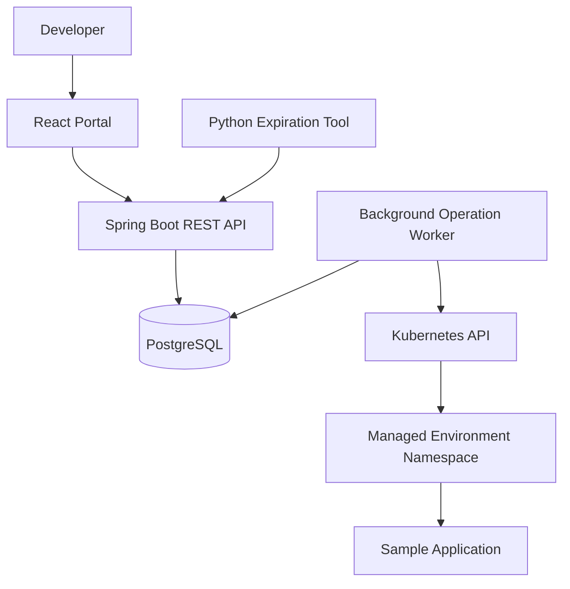

# Developer Platform Lab

A hands-on internal developer platform for provisioning development environments, deploying a sample application, and understanding operational status through a self-service portal.

> **Project status:** Design phase. This README describes the intended architecture and delivery plan, not features that are already implemented.
>
> **Disclaimer:** This is an independent portfolio project inspired by platform engineering challenges. It is not an eBay product and does not reproduce eBay’s proprietary systems.

## 1. Project Purpose

Developer Platform Lab explores how a platform engineering team can reduce friction in the software development lifecycle.

The platform will let a developer:

1. Select a supported sample service.
2. Request an isolated development environment.
3. Follow provisioning progress.
4. View application readiness and diagnostic information.
5. Delete the environment.
6. Allow expired environments to be cleaned up automatically.

The project prioritizes working infrastructure, understandable failures, and safe automation over a large feature list.

## 2. Goals

- Build a usable self-service portal with React and TypeScript.
- Design a Java/Spring Boot REST API.
- Implement persistent asynchronous operations.
- Provision real resources in a local Kubernetes cluster.
- Automate environment expiration with Python.
- Demonstrate testing, observability, and operational documentation.
- Explain architectural decisions and trade-offs clearly.

### Initial non-goals

The first release will not include:

- Production workloads or production-grade availability.
- Public internet exposure.
- Strong isolation between untrusted tenants.
- Multi-cluster or multi-cloud orchestration.
- Arbitrary user-provided container images or Kubernetes manifests.
- A replacement for a CI/CD system.
- AI-generated automated remediation.

These boundaries keep the first version achievable and its security assumptions explicit.

## 3. Primary User Journey

### Create an environment

1. The developer opens the portal.
2. They enter an environment name and choose an allowed lifetime.
3. The portal submits a request to the backend.
4. The backend records the environment and a provisioning operation.
5. A background worker claims the operation.
6. The worker creates the environment’s Kubernetes resources.
7. The portal displays progress while the worker checks readiness.
8. The environment becomes ready, or the operation reports a useful failure.

### Delete an environment

1. The developer requests deletion.
2. The backend records a deletion operation.
3. The worker verifies platform ownership of the target namespace.
4. The worker requests namespace deletion.
5. The platform confirms removal before reporting completion.

### Expire an environment

The Python cleanup tool identifies expired environments through the backend API and requests deletion using the same workflow as the portal.

It does not independently delete arbitrary Kubernetes namespaces.

## 4. Technology Choices

| Area | Initial choice | Purpose |
|---|---|---|
| Frontend | React, TypeScript, Vite | Developer portal |
| Backend | Java, Spring Boot | APIs and orchestration |
| Backend build | Maven Wrapper | Repeatable builds |
| Persistence | PostgreSQL | Environments, operations, audit history |
| Schema management | Flyway | Versioned database migrations |
| Runtime | Local Kubernetes cluster using kind | Real provisioning target |
| Local dependencies | Docker Compose | PostgreSQL and supporting services |
| Automation | Python | Expiration and operational scripts |
| Testing | JUnit, backend integration tests, frontend tests | Workflow confidence |
| CI | GitHub Actions | Automated validation |

Exact supported versions will be pinned during scaffolding.

The backend and worker initially live in one application, with separate packages and responsibilities. A separate worker deployment can be introduced later if justified.

## 5. Development Workflow

### VS Code

Use VS Code for:

- React and TypeScript.
- Documentation.
- Kubernetes manifests.
- Python automation.
- Repository-wide configuration.

### IntelliJ IDEA

Use IntelliJ IDEA for:

- The Spring Boot backend.
- Java application code.
- Backend tests.
- Debugging API and worker behavior.

### Shared repository

Both editors open directories from the same local clone:

- Open the repository root in VS Code.
- Open `backend/` as a Maven project in IntelliJ IDEA.
- Use one Git working tree and the same feature branch.
- Avoid editing the same file simultaneously in both editors.

No separate frontend and backend repositories are required.

## 6. Architecture



### Responsibility boundaries

**Portal**
- Collects input.
- Displays environment and operation state.
- Shows actionable errors.
- Never receives Kubernetes credentials.

**REST API**
- Validates requests.
- Persists desired changes and operations.
- Returns operation identifiers.
- Exposes status and diagnostic information.

**Worker**
- Claims pending operations.
- Reconciles requested resources with observed resources.
- Checks readiness.
- Records progress, failures, and completion.

**PostgreSQL**
- Stores requested state and operation history.
- Does not replace Kubernetes as the source of observed runtime state.

**Kubernetes**
- Runs the sample application.
- Exposes actual workload readiness and resource state.

**Python automation**
- Finds expired environments through the API.
- Requests safe deletion.
- Supports dry-run mode.

## 7. Repository Structure

```text
developer-platform-lab/
├── frontend/
│   ├── src/
│   │   ├── api/
│   │   ├── components/
│   │   ├── features/
│   │   │   ├── environments/
│   │   │   └── operations/
│   │   └── pages/
│   └── package.json
├── backend/
│   ├── src/main/java/
│   │   └── <base-package>/
│   │       ├── environment/
│   │       ├── operation/
│   │       ├── kubernetes/
│   │       ├── audit/
│   │       └── config/
│   ├── src/main/resources/
│   │   └── db/migration/
│   ├── src/test/
│   └── pom.xml
├── automation/
│   ├── cleanup_expired.py
│   └── tests/
├── infra/
│   ├── kind/
│   └── kubernetes/
├── sample-app/
├── docs/
│   ├── architecture.md
│   ├── api.md
│   ├── demo.md
│   ├── decisions/
│   └── runbooks/
├── .github/workflows/
├── compose.yaml
├── .env.example
└── README.md
```

This is a planned structure. Directories will be introduced as their functionality is implemented.

## 8. Domain Model

### Environment

Represents a requested development environment.

Key fields:

- `id`
- `name`
- `namespace`
- `templateId`
- `status`
- `expiresAt`
- `createdAt`
- `updatedAt`
- `lastErrorCode`
- `lastErrorMessage`

Initial environment states:

- `REQUESTED`
- `PROVISIONING`
- `READY`
- `FAILED`
- `DELETING`
- `DELETED`
- `DELETE_FAILED`

Environment readiness is a last-observed state, not a guarantee of continuous application health.

### Operation

Represents a durable unit of background work.

Key fields:

- `id`
- `environmentId`
- `type`
- `status`
- `attemptCount`
- `nextAttemptAt`
- `leaseExpiresAt`
- `startedAt`
- `completedAt`
- `errorCode`
- `errorMessage`

Initial operation types:

- `CREATE_ENVIRONMENT`
- `DELETE_ENVIRONMENT`

Initial operation states:

- `PENDING`
- `RUNNING`
- `SUCCEEDED`
- `FAILED`

### Audit Event

Records important actions and transitions.

Key fields:

- `id`
- `environmentId`
- `operationId`
- `action`
- `actor`
- `timestamp`
- `details`

The MVP uses an explicitly labeled local-development actor. This is not a substitute for authenticated identity.

## 9. Proposed REST API

All routes use the `/api/v1` prefix.

| Method | Route | Purpose |
|---|---|---|
| GET | `/environments` | List environments with bounded pagination and filters |
| POST | `/environments` | Request environment creation |
| GET | `/environments/{id}` | Read environment details |
| DELETE | `/environments/{id}` | Request environment deletion |
| GET | `/environments/{id}/events` | Read sanitized platform and runtime events |
| GET | `/operations/{id}` | Read operation progress |

### API behavior

- Creation and deletion return `202 Accepted` when asynchronous work is accepted.
- Responses identify the environment and operation.
- Creation supports an `Idempotency-Key` header.
- Reusing a key with the same request returns the original result.
- Reusing a key with different input returns a conflict.
- Repeated deletion requests do not create competing deletion operations.
- Errors include a stable code, useful message, and request identifier.
- Kubernetes credentials and sensitive internal details are never returned.

The detailed request and response schemas will be defined in `docs/api.md`.

## 10. Reliable Background Work

The first version uses a PostgreSQL-backed operation queue instead of adding a message broker.

Design requirements:

- Create the environment and operation in one database transaction.
- Claim work atomically.
- Use leases so abandoned work can be recovered after a worker restart.
- Use bounded retries with backoff for transient failures.
- Do not automatically retry permanent validation or permission errors.
- Make provisioning safe to repeat.
- Use deterministic namespace names derived from environment identifiers.
- Set deadlines for provisioning and deletion.
- Preserve useful failure context.

No database transaction remains open while waiting for Kubernetes.

Successful operations retain enough history to explain what happened.

## 11. Kubernetes Provisioning

Each environment receives a platform-managed namespace containing:

- A Deployment for the approved sample application.
- An internal Service.
- Configuration required by that application.
- Resource requests and limits.
- A ResourceQuota.
- Readiness and liveness probes.
- Platform ownership labels.
- Network policies where supported by the selected cluster networking.

Namespace separation alone is not a strong security boundary.

### Safety requirements

- Validate namespace identifiers.
- Restrict operations to the configured local cluster.
- Never delete a namespace based only on its name prefix.
- Verify ownership labels and the matching persisted environment record.
- Use narrowly scoped permissions where feasible.
- Document permissions that necessarily operate at cluster scope.
- Never store kubeconfig files or secrets in Git.
- Do not accept arbitrary manifests from portal users.

The initial demo accesses the sample application through a documented local port-forward workflow rather than public ingress.

## 12. Frontend Experience

### Environment list

- Name and status.
- Creation and expiration times.
- Refresh behavior.
- Empty, loading, and error states.

### Create environment form

- Validated environment name.
- Supported template.
- Allowed lifetime.
- Clear submission feedback.

### Environment detail

- Provisioning progress.
- Latest observed readiness.
- Operation history.
- Sanitized diagnostic events.
- Delete confirmation.

The UI distinguishes “request accepted,” “resources created,” and “application ready.”

## 13. Cleanup Automation

The Python expiration tool will:

1. Fetch expired, non-deleted environments.
2. Display intended actions in dry-run mode.
3. Request deletion through the backend.
4. Handle already-deleting environments safely.
5. Record a structured execution summary.
6. Return a nonzero exit code for actionable failures.

Initial execution is manual or locally scheduled.

A Kubernetes CronJob can be added later without changing deletion semantics.

## 14. Local Setup Plan

The intended workflow is:

1. Install the pinned development prerequisites.
2. Clone the repository.
3. Copy `.env.example` to a local environment file.
4. Start PostgreSQL.
5. Create the dedicated kind cluster.
6. Build and load the sample application image.
7. Configure backend access to that cluster.
8. Run the backend from IntelliJ IDEA or Maven.
9. Run the frontend from VS Code.
10. Provision the first environment.

Executable commands will be added and verified during implementation.

Until authentication and additional hardening exist, run this project only in a trusted local environment. Do not expose it publicly.

## 15. Testing Strategy

### Backend

- Input validation.
- State transitions.
- Request idempotency.
- Atomic operation creation.
- Worker claiming and lease recovery.
- Retry classification.
- Safe deletion checks.
- Database integration tests.

### Frontend

- Form validation.
- Loading, empty, and failure states.
- Operation polling.
- Delete confirmation.
- API error presentation.

### Automation

- Expiration selection.
- Dry-run behavior.
- Repeated execution.
- API failures.
- Already-deleting environments.

### End-to-end

- Create an environment successfully.
- Observe readiness.
- Diagnose an intentionally unhealthy workload.
- Recover interrupted provisioning.
- Delete an environment.
- Clean up an expired environment.

Tests requiring a real cluster will be identified separately from fast pull-request checks.

## 16. Observability

Initial observability includes:

- Structured backend logs.
- Request, environment, and operation identifiers.
- Health endpoints.
- Operation duration and outcome measurements.
- Sanitized Kubernetes events.
- Audit history.

Measurements will distinguish:

- Request acceptance latency.
- Queue waiting time.
- Provisioning duration.
- Application readiness time.
- Deletion duration.

Any reported performance results will include the test environment and method.

## 17. Delivery Roadmap

### Milestone 1: Foundation

- Scaffold frontend and backend.
- Configure PostgreSQL and migrations.
- Establish CI.
- Define API contracts.

### Milestone 2: First vertical slice

- Create an environment from the portal.
- Persist the operation.
- Provision the sample workload.
- Display readiness or failure.

### Milestone 3: Safe lifecycle

- Implement deletion.
- Add expiration cleanup.
- Test retries and worker restart recovery.
- Add ownership safeguards.

### Milestone 4: Portfolio polish

- Improve accessibility and UI feedback.
- Add operational documentation.
- Complete integration tests.
- Record a repeatable demo.
- Document limitations and trade-offs.

### Later candidates

- Authentication and team-based authorization.
- Service catalog and ownership.
- Multiple approved templates.
- Deployment versions and history.
- GitOps integration.
- AI-assisted diagnosis using sanitized evidence.
- Multi-cluster support.

Later features are not commitments for the initial release.

## 18. Demo Acceptance Criteria

The initial release is complete when a reviewer can:

1. Follow the documented setup from a clean clone.
2. Create an environment through the portal.
3. See real Kubernetes resources created.
4. Observe a healthy sample application.
5. Inspect an intentionally failed provisioning attempt.
6. Confirm duplicate requests do not create duplicate resources.
7. Restart the backend without silently losing pending work.
8. Delete an environment safely.
9. Demonstrate expiration cleanup in dry-run and execution modes.

## 19. Interview Discussion Topics

This project should support a clear discussion of:

- Why provisioning is asynchronous.
- How repeated requests are handled.
- How workers recover after failure.
- Why namespace ownership checks matter.
- How desired state differs from observed state.
- Why the MVP avoids unnecessary microservices.
- How developer productivity could be measured.
- What would need to change before enterprise deployment.

## 20. Limitations

This project demonstrates engineering decisions in a controlled environment.

It does not establish:

- Enterprise-scale performance.
- Production readiness.
- Compliance certification.
- Strong multi-tenant isolation.
- Operational experience at eBay’s scale.

Known limitations and unfinished features will remain visible as implementation progresses.
